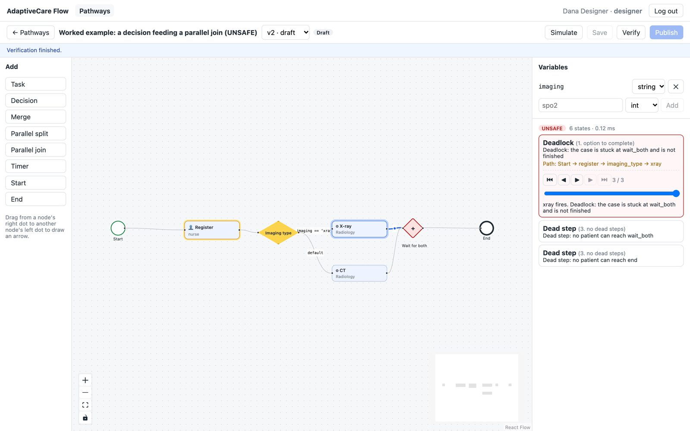
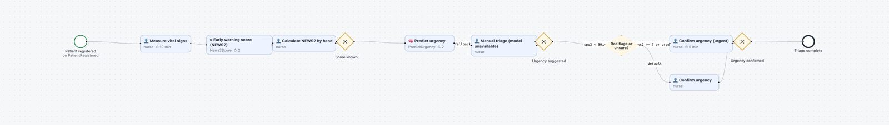
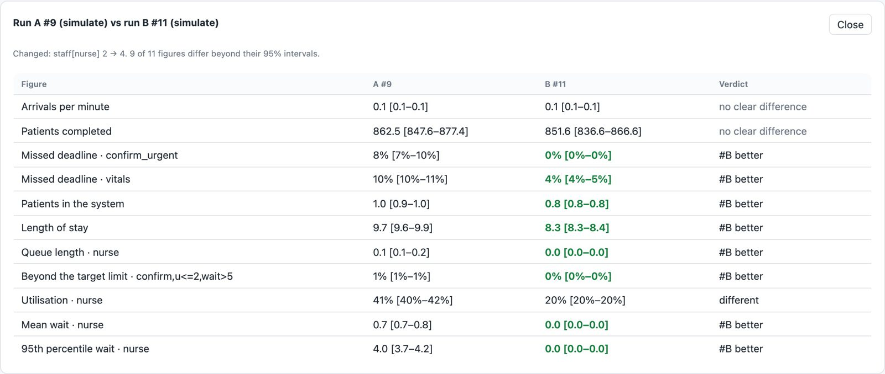

# AdaptiveCare Flow

**A low-code platform for clinical pathways.** Hospital staff draw a care pathway as a flowchart.
The system proves it is safe, predicts how many staff it needs, deploys it as its own
microservice, and runs it for every patient by putting the right task in the right person's
worklist at the right moment.

Built as a university software engineering project (Scrum, sprints 0–7 plus closure), with
three algorithms at its core:

| | Algorithm | What it answers |
|---|-----------|-----------------|
| 1 | **Verifier** — state-space search over the pathway's token semantics | *Can a patient ever get stuck, have work done twice, or reach a step without its data?* |
| 2 | **Execution Engine** — event-sourced token interpreter | *Where is each patient now, and what happens next?* Duplicate-safe, crash-safe, with retries, escalation and compensation. |
| 3 | **Simulator and Staffing Advisor** — discrete-event simulation with 95% confidence intervals | *How long will patients wait with this staffing, and what is the cheapest staffing that meets our targets?* |



## Features

- **Pathway editor** (React Flow): tasks for people, services or the ML model, decisions, merges,
  parallel split/join, timers; variables with types; conditions checked as you type; deadlines,
  escalation chains, retries, answer timeouts, fallbacks, undo actions and override checks.
- **Verify** before publishing: five soundness properties plus data-flow and type checks, with
  the shortest counterexample replayed token by token on the canvas.
- **Immutable versions**: Draft → Verified → Published → Deployed → Draining → Retired. Running
  cases always finish on the version they started on.
- **Deploy** a published version as its own engine (one Docker container per version);
  pathways chain through events (Triage → Assessment → Visit).
- **Worklists** for nurses, charge nurses and doctors: claim, complete, release, report a problem;
  overdue work escalates and sends email/SMS alerts.
- **Decision support**: an urgency model (with SHAP reasons and calibrated confidence) and a
  NEWS2 early-warning score service. A nurse always confirms, and changing the model's suggestion
  requires a logged reason.
- **Simulate and compare** staffing scenarios; the advisor recommends the cheapest staffing that
  meets every deadline target.
- **Monitoring**: dashboard, full case history and patient journey, service health and metrics,
  Prometheus/Grafana, JSON logs with case ids.
- **Security**: JWT login, a permission matrix at the gateway, separation of duties (designers
  publish, only admins deploy), patient names and birth dates encrypted at rest.

| Emergency triage pathway | Simulation and comparison |
|---|---|
|  |  |

## Roles

| Role | Does |
|------|------|
| Designer | Draws, verifies, simulates and publishes pathways |
| Admin | Manages users, deploys and undeploys versions, monitors services, sets alert contacts |
| Nurse | Registers patients, manages beds, does nursing tasks (vital signs, urgency confirmation, transfers) |
| Charge nurse | Receives escalated overdue tasks; otherwise works as a nurse |
| Doctor | Imaging and the doctor's review (admit or discharge) |
| Manager | Dashboards, case histories, final escalation alerts, simulations |

## Architecture

Eleven FastAPI services behind one gateway, communicating through events (RabbitMQ topic
exchange `care.events`; an in-memory bus in development), each with its own PostgreSQL schema.
Every service uses the same token rules from the shared `pathway-core` package, so the
verifier, simulator and engine always agree on what a pathway means.

```
web (React) ──► gateway ──► auth · designer · verifier · simulator · deployer
                   │            patient · worklist · ml · scores · engine-<pathway>-v<n> …
                   └──────────── events: care.events (RabbitMQ) ────────────┘
```

## Quick start

### With Docker

```bash
cp .env.example .env
docker compose up --build
```

Open <https://localhost:8443> (a self-signed certificate is made at start; <http://localhost:8080>
redirects there) and sign in with `ADMIN_EMAIL` / `ADMIN_PASSWORD` from `.env`.
<http://localhost:8000/health/all> shows every service's health. Prometheus and Grafana (optional):
`docker compose --profile monitoring up -d`, then <http://localhost:9090> and
<http://localhost:3000>. Every service logs JSON lines with the case id (`LOG_FORMAT=text` for
plain lines).

### Without Docker (development)

`dev.sh` runs every service in one process with an in-memory bus in place of RabbitMQ; pressing
Deploy starts that version's engine in the same process.

```bash
python3 -m venv .venv
.venv/bin/pip install -e packages/pathway-core -e packages/care-events -e packages/service-metrics -r requirements-dev.txt
cp .env.example .env
./scripts/dev.sh                          # gateway :8000 … simulator :8008, scores :8009, engines :8010+
.venv/bin/python scripts/seed_demo.py     # demo users, beds, the clinical pathways verified, published, deployed
npm --prefix web install && npm --prefix web run dev   # web app on http://localhost:5173
```

### Demo accounts

Development fixtures only (from `.env.example` and `scripts/seed_demo.py`); change them for any
real deployment.

| Role | Email | Password |
|------|-------|----------|
| Admin | admin@adaptivecare.test | admin-demo-1 |
| Designer | designer@adaptivecare.test | designer-demo-1 |
| Nurse | nurse@adaptivecare.test | nurse-demo-1 |
| Charge nurse | charge@adaptivecare.test | charge-demo-1 |
| Doctor | doctor@adaptivecare.test | doctor-demo-1 |
| Manager | manager@adaptivecare.test | manager-demo-1 |

To try it: sign in as the nurse, register a patient, and complete "Measure vital signs"; the
urgency confirmation appears with the NEWS2 score and the model's suggestion. As the designer,
open "Imaging (has a deadlock)" and press Verify.

## Develop and test

```bash
python3 -m venv .venv
.venv/bin/pip install -e packages/pathway-core -e packages/care-events -e packages/service-metrics -r requirements-dev.txt
.venv/bin/python -m pytest --cov
.venv/bin/ruff check packages services
.venv/bin/mypy packages/pathway-core/src services/verifier/verifier services/auth/auth services/gateway/gateway services/designer/designer services/patient/patient \
  services/engine/engine services/worklist/worklist services/ml/ml services/deployer/deployer \
  services/simulator/simulator packages/care-events/src services/ml/training packages/service-metrics/src services/scores/scores scripts/export_uml.py scripts/load_test.py scripts/sus_score.py scripts/traceability.py scripts/build_report.py scripts/report_charts.py
npm --prefix web test && npm --prefix web run typecheck
npm --prefix web run e2e    # browser tests in Chrome; needs dev.sh, seed_demo.py and npm run dev
```

If `import pathway_core` fails outside the repo root on macOS with Python 3.13, macOS has
marked the venv's `.pth` files hidden and Python skips them. Fix:
`chflags nohidden .venv/lib/python3.*/site-packages/*.pth`

Retrain the urgency model (uses `data/ktas/data.csv` when present, otherwise synthetic data):

```bash
cd services/ml && PYTHONPATH=. ../../.venv/bin/python -m training.train
```

Measure (see `docs/measurements/nfr-results.md`):

```bash
.venv/bin/python -m pytest -s services/engine/tests/test_performance.py   # NFR-PERF-02
.venv/bin/python scripts/load_test.py http://localhost:8000 10              # stress test, dev stack running
.venv/bin/python scripts/sus_score.py docs/alpha-test/sus-results.csv       # NFR-USE-02 after the alpha test
```

Build the report (pandoc; charts need matplotlib; diagrams need `plantuml.jar`):

```bash
PLANTUML_JAR=/path/to/plantuml.jar ./scripts/render_uml.sh   # optional: diagram images
python scripts/report_charts.py                               # charts from git and measurements
.venv/bin/python scripts/build_report.py                      # docs/report/AdaptiveCare-Flow-Report.docx
.venv/bin/python scripts/traceability.py                      # docs/closure/traceability.md
```

Run the verifier on its own:

```bash
cd services/verifier && ../../.venv/bin/uvicorn verifier.main:app --reload
curl -s -X POST localhost:8000/verify -H 'content-type: application/json' -d @../../pathways/imaging_deadlock.json
```

## Repository layout

| Path | What it is |
|------|------------|
| `packages/pathway-core/` | Pathway model, the eight token rules, condition language, task settings (DES-04) |
| `services/verifier/` | **Algorithm 1** — state-space search, soundness checks, data-flow fixed point, counterexamples |
| `services/auth/` | Users, roles, bcrypt, JWT access/refresh tokens (AUTH-01/02) |
| `services/gateway/` | Single entry point: token check, permission matrix, proxy (AUTH-03) |
| `services/designer/` | Pathways, versions, Verify, Publish, live condition checks (DES-01..05) |
| `services/patient/` | Patients (PAT-01, name and birth date encrypted: NFR-SEC-05) and beds (PAT-02, the `BedService` worker) |
| `packages/care-events/` | Event envelope, bus (in-memory and RabbitMQ), outbox and inbox |
| `packages/service-metrics/` | Request metrics for every service: `/metrics` (Prometheus) and `/metrics.json` (MON-03) |
| `services/engine/` | **Algorithm 2** — token interpreter, event store, replay, snapshots, timers, retries, escalation, compensation |
| `services/worklist/` | Tasks for people (WRK-01/02), email/SMS alerts (WRK-03), case history and dashboard (MON-01/02) |
| `services/scores/` | NEWS2 early warning score as a task type: a new service, no engine change (CLN-04) |
| `services/ml/` | Urgency model: training pipeline (`training/`), prediction with SHAP reasons (ML-01/02) |
| `services/deployer/` | Deploy: PIM → PSM, start the engine, health check (DEP-01); undeploy with draining (DEP-02) |
| `services/simulator/` | **Algorithm 3** — discrete-event simulation, 95% intervals, Staffing Advisor, Erlang C validation |
| `tests/system/` | In-process system tests: the three clinical pathways end to end with every worker |
| `web/` | React + React Flow editor, tasks, patients, monitoring, alerts, simulation and comparison |
| `scripts/` | `dev.sh` (run without Docker), `seed_demo.py`, `export_uml.py` (pathway → PlantUML), `load_test.py`, `sus_score.py` |
| `monitoring/` | Prometheus configuration (Compose profile `monitoring`) |
| `docs/measurements/` | Measured NFR results and the stress test |
| `docs/alpha-test/` | Alpha test script and SUS form (NFR-USE-02) |
| `docs/closure/` | Acceptance checklist, UML check, traceability, demo rehearsal |
| `docs/report/` | The final report: chapters (Markdown), figures, the built `.docx` |
| `docs/ml/` | Model card and metrics of the urgency model |
| `pathways/clinical/` | **CLN-01..04**: Triage v3 (with NEWS2), Assessment, Visit, chained by the events their End nodes announce |
| `pathways/` | Examples: `triage.json` (v1, parallel), `imaging_deadlock.json` (UNSAFE), `imaging_fixed.json` |
| `contracts/events.md` | Event envelope and catalog, REST contract |
| `docs/uml/` | PlantUML diagrams U01–U32 and E1 (U31/U32 final) |
| `docs/ai-log/` | Prompt log per sprint (requirement P21) |
| `docs/daily/` | Daily scrum notes |
| `CLAUDE.md` | Rules file for AI tools |

## Status

| Sprint | Goal | State |
|--------|------|-------|
| 0 | Outline planning and architecture | Skeleton, CI, rules file, UML drafts done |
| 1 | Pathway model, editor, login | Done: auth, gateway permission matrix, designer, React Flow editor |
| 2 | Algorithm 1: Verifier | Done: Verifier, counterexample replay (NFR-USE-01), task settings (DES-04), patients (PAT-01), UML U07–U12 |
| 3 | Algorithm 2: Engine core | Done: ENG-01..05, WRK-01, fault-injection and replay tests; RabbitMQ run pending (Docker) |
| 4 | Algorithm 2 reliability and Deploy | Done: ENG-06..09, DEP-01; Docker runtime and RabbitMQ not yet run (Docker) |
| 5 | Algorithm 3: Simulator and Advisor | Done: SIM-01..04, DES-06, DEP-02; Erlang C 92/100, NFR-PERF-03 5 s |
| 6 | ML and the three clinical pathways | Done: ML-01/02 (synthetic data until the KTAS file is added), WRK-02, PAT-02, CLN-01..03 |
| 7 | Hardening and measurement | Done: CLN-04, WRK-03, MON-01..03, SIM-05, NFR-SEC-05, NFR-PERF-01..04 measured; alpha test (SUS) still to run with classmates |
| Closure | Acceptance, report, rehearsal | Done: requirements checked (`docs/closure/`), NFR-ROB-01 fixed (decision 0008), diagrams checked against the code, report built (`docs/report/`); open: alpha test, Docker run, rehearsals |

## Quality

About 650 Python tests (unit, property-based, fault-injection, replay and in-process system
tests) at about 93% coverage, web unit tests with Vitest, and Playwright browser tests.
`ruff`, `mypy --strict`, a cyclomatic complexity limit of 10, `bandit` and `pip-audit` all pass.
Measured results for every non-functional requirement are in `docs/measurements/` and chapter 16
of the report.

## Known limitations

- The Docker Compose, RabbitMQ and PostgreSQL paths are written but have not been run against live
  daemons; all measurements come from the in-process runtime with SQLite.
- The urgency model is trained on synthetic data; its accuracy is not clinical evidence.
- This is decision support for a university project, not a medical device. Do not use it with
  real patient data.

## Documentation

- `docs/report/` — the final report (chapters in Markdown and the built `.docx`)
- `docs/decisions/` — design decisions 0001–0009
- `docs/uml/` — PlantUML diagrams
- `docs/closure/` — acceptance checklist, traceability, demo rehearsal
- `docs/ai-log/` — how AI tools were used, sprint by sprint
